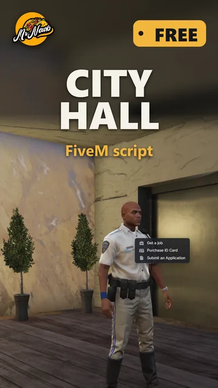

# MrNewbCityHall


City hall NPCs for ID replacements, walk-up jobs, and applications with optional Discord webhooks.

[Documentation](https://mrnewb.github.io/docs/mrnewbcityhall) | [Install guide](https://mrnewb.github.io/docs/mrnewbcityhall/install) | [Tebex](https://mrnewbscripts.tebex.io/) | [Discord](https://discord.gg/mrnewbscripts) | [Short](https://www.youtube.com/shorts/eTsTBtN1Oy8)

<a href="https://www.youtube.com/shorts/eTsTBtN1Oy8"></a>

Documentation is available at https://mrnewb.github.io/docs/

## Features

- Walk-up job assignment per desk (`availableJobs` to grade)
- Bank-paid ID replacement via `um-idcard`, `bl_idcard`, or an `id_card` inventory item
- Job applications with Discord webhooks
- Multiple desks, optional map blips, target via the bridge
- Application cooldown per character (in memory)
- Webhook URLs stay **server-only** - empty or missing URLs reject the submit

## Install

Needs [ox_lib](https://github.com/overextended/ox_lib) and [Newb_Bridge](https://github.com/MrNewb/Newb_Bridge). This resource does not ship `[INSTALL]/` items. Start order and ID paths: [install guide](https://mrnewb.github.io/docs/mrnewbcityhall/install).

```cfg
ensure ox_lib
ensure Newb_Bridge
ensure MrNewbCityHall
```

## Config

| File | Realm | Contents |
| --- | --- | --- |
| `resource/open/shared/cityhall.lua` | shared | Locations, ID price, interact distance, application cooldown, available jobs |
| `resource/open/shared/applications.lua` | shared | Application questions per job |
| `resource/open/server/webhooks.lua` | **server only** | Per-job Discord webhook URLs |

Submits are rejected until a valid Discord webhook URL is set for that job. Details: [documentation](https://mrnewb.github.io/docs/mrnewbcityhall).
